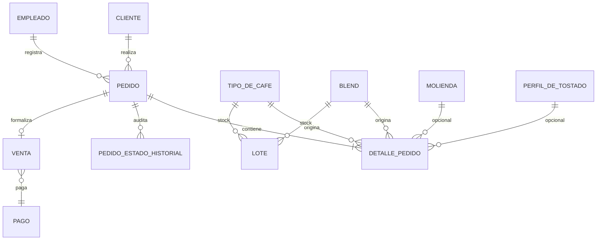
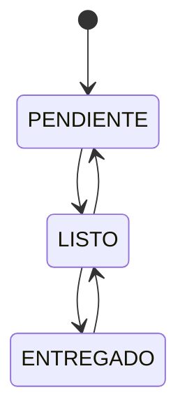

# Feature Pedidos: documentación técnica y funcional

> **Estado:** núcleo implementado, fusionado en `main` y cubierto por pruebas de servicios y CRUD.
>
> **Base de análisis:** árbol de trabajo actual de `main`. La rama `feature/pedidos`
> aportó el núcleo de negocio y la API canónica; la integración posterior agregó
> el adaptador `/panel` que consume el frontend. Este documento describe el módulo
> completo y diferencia ambas partes cuando corresponde.

| Dato | Valor |
|---|---|
| Rama | `feature/pedidos` |
| Último commit de la rama | `91438de` — `feat(pedidos): implementar módulo completo de pedidos para demo` (24/10/2026) |
| Merge en `main` | `0545e92` — `Merge branch 'feature/pedidos'` (29/10/2026) |
| Módulo backend | `backend/app/modules/pedidos/` |
| Frontend | `frontend/src/pages/Pedidos.jsx`, `frontend/src/components/forms/PedidoForm.jsx` |
| Cambio OpenSpec | `openspec/changes/002pedidos/` |
| Spec vigente | `openspec/specs/pedidos/spec.md` |

## Índice

1. [Resumen funcional](#1-resumen-funcional)
2. [Alcance](#2-alcance)
3. [Arquitectura](#3-arquitectura)
4. [Modelo de datos](#4-modelo-de-datos)
5. [Reglas de negocio](#5-reglas-de-negocio)
6. [API HTTP](#6-api-http)
7. [Frontend](#7-frontend)
8. [Pruebas](#8-pruebas)
9. [Puesta en marcha](#9-puesta-en-marcha)
10. [Limitaciones y deuda técnica](#10-limitaciones-y-deuda-técnica)
11. [Próximos pasos](#11-próximos-pasos)
12. [Referencias](#12-referencias)

---

## 1. Resumen funcional

El módulo de pedidos cubre el ciclo de vida de una venta de café tostado:

1. **Alta del pedido**: se elige cliente, productos (tipo de café o blend), kilos,
   molienda y perfil de tostado. El backend calcula precios y totales.
2. **Reserva de stock**: se descuenta café tostado de los lotes disponibles con
   criterio FIFO (primero en vencer, primero en salir).
3. **Preparación y entrega**: el pedido avanza por los estados
   `PENDIENTE → LISTO → ENTREGADO`, con registro de cada cambio.
4. **Cuenta corriente B2B**: al entregar un pedido de un cliente mayorista, el
   total se suma a su saldo; si la entrega se revierte, el saldo se descuenta.
5. **Cancelación**: un pedido `PENDIENTE` puede eliminarse y el stock vuelve a
   los lotes.

El panel administrativo ofrece vista de tabla y tablero Kanban, filtros por
cliente/estado/texto, alta y edición en modal, detalle y eliminación. El portal
de clientes reutiliza el mismo adaptador `/panel` para que un cliente registre
su propio pedido.

---

## 2. Alcance

### 2.1 Incluido

- Creación de pedidos con uno o más ítems.
- Cálculo automático de subtotales y total.
- Validación y consumo de stock de café tostado.
- Idempotencia en la API canónica mediante `idempotency_key`.
- Listado, detalle, edición y eliminación.
- Máquina de estados con historial de auditoría.
- Efectos sobre la cuenta corriente de clientes mayoristas.
- Adaptador de contrato plano para el panel (`/pedidos/panel`).
- Pruebas de CRUD y de reglas de negocio.

### 2.2 Fuera de alcance

- Pasarelas de pago y conciliación.
- Facturación electrónica.
- Gestión de envíos programados (pertenece al módulo `envios`).
- Notificaciones por email, WhatsApp o push.
- Límite de crédito y scoring de clientes.
- Reportes avanzados de ventas.
- Devoluciones parciales de ítems.

---

## 3. Arquitectura

El proyecto usa un **vertical slice** por dominio. El módulo de pedidos agrupa sus
propias capas y no importa routers de otros módulos.

| Capa | Archivo | Responsabilidad |
|---|---|---|
| HTTP | `backend/app/modules/pedidos/router.py` | Rutas, dependencias, validación de entrada y códigos HTTP. |
| Contratos | `backend/app/modules/pedidos/schemas.py` | Schemas Pydantic de entrada/salida, incluidos los del panel. |
| Acceso a datos | `backend/app/modules/pedidos/crud.py` | Consultas y persistencia sin reglas de negocio. |
| Negocio | `backend/app/modules/pedidos/services.py` | Cálculo de precios, FIFO, idempotencia, estados y cuenta corriente. |
| Modelos | `backend/app/modules/pedidos/models.py` | Tablas SQLAlchemy del pedido y reexportes de catálogos. |

### 3.1 Flujo de creación

```text
Frontend
  │  POST /api/v1/pedidos/panel  (o POST /api/v1/pedidos/)
  ▼
Router FastAPI
  │  valida JWT y payload Pydantic
  ▼
PedidoPanelService / PedidoService
  │  1. resuelve cliente y empleado
  │  2. valida ítems y calcula precio_kg + subtotal + total
  │  3. resuelve idempotency_key y busca duplicados
  │  4. valida stock disponible por producto
  │  5. crea pedido + detalles
  │  6. consume lotes FIFO
  │  7. registra historial inicial
  ▼
Respuesta: pedido creado (contrato canónico o contrato plano del panel)
```

El router transforma errores de negocio (`ValueError`) en HTTP 400 y mantiene
las rutas del panel antes de `/{pedido_id}` para que `panel` no se interprete
como un identificador numérico.

---

## 4. Modelo de datos

### 4.1 Diagrama entidad-relación



`Pago` y `Venta` existen en el módulo, pero el flujo actual de pedidos no las
crea ni las consulta. Son parte del modelo heredado y quedan para una etapa
posterior.

### 4.2 Tabla `pedido`

| Campo | Tipo | Notas |
|---|---|---|
| `id` | `Integer` | Clave primaria. |
| `fecha` | `DateTime` | Fecha/hora del pedido. |
| `metodo_de_despacho` | `Enum(MetodoDespacho)` | Retiro en local, envío propio o transporte externo. |
| `estado` | `Enum(EstadoPedido)` | `PENDIENTE`, `LISTO` o `ENTREGADO`. |
| `total` | `Numeric(10,2)` | Calculado por el backend. |
| `idempotency_key` | `String(64)` | Único y nullable. Evita duplicados en la API canónica. |
| `medio_contacto` | `String(50)` | WhatsApp, email, teléfono o presencial. |
| `observaciones` | `Text` | Notas libres. |
| `cliente_persona_id` | `Integer` | FK a `cliente.persona_id`. |
| `empleado_persona_id` | `Integer` | FK a `empleado.persona_id`; nullable para autoservicio del cliente. |

Relaciones: `cliente`, `empleado`, `detalles`, `historial_estados` y `venta`
(uno a uno opcional).

### 4.3 Tabla `detalle_pedido`

| Campo | Tipo | Notas |
|---|---|---|
| `id` | `Integer` | Clave primaria. |
| `pedido_id` | `Integer` | FK a `pedido.id`. |
| `cantidad_kg` | `Numeric(10,2)` | Kilos solicitados. |
| `subtotal` | `Numeric(10,2)` | `precio_kg × cantidad_kg`. |
| `tipo_de_cafe_id` | `Integer` | Origen cuando el producto es un tipo de café. |
| `blend_id` | `Integer` | Origen cuando el producto es un blend. |
| `molienda_id` | `Integer` | Opcional; suma valor por kg. |
| `perfil_de_tostado_id` | `Integer` | Opcional; suma valor por kg. |

El schema permite enviar `tipo_de_cafe_id` y `blend_id` a la vez. El cálculo de
precio prioriza `tipo_de_cafe_id`; para evitar consumos ambiguos, cada detalle
debería enviar solo uno de los dos orígenes.

### 4.4 Tabla `pedido_estado_historial`

| Campo | Tipo | Notas |
|---|---|---|
| `id` | `Integer` | Clave primaria. |
| `pedido_id` | `Integer` | FK a `pedido.id`, indexado. |
| `estado_anterior` | `Enum(EstadoPedido)` | Nullable en el alta inicial. |
| `estado_nuevo` | `Enum(EstadoPedido)` | Estado resultante. |
| `usuario_id` | `Integer` | FK a `cuenta.id`; nullable. |
| `timestamp` | `DateTime` | Momento del cambio. |

### 4.5 Tablas relacionadas

- **`cliente`**: `persona_id`, `tipo`, `direccion_de_entrega`,
  `saldo_cuenta_corriente`, `limite_credito`, `fecha_alta`.
- **`lote`**: stock físico. Para pedidos solo se consideran lotes
  `tipo = TOSTADO`; `kg_disponibles` es el saldo vendible y `kg_reales` la
  capacidad original.
- **Catálogos**: `tipo_de_cafe`, `blend`, `molienda`, `perfil_de_tostado`.

### 4.6 Enumeraciones

| Enum | Valores |
|---|---|
| `EstadoPedido` | `PENDIENTE`, `LISTO`, `ENTREGADO` |
| `MetodoDespacho` | `Retiro en local`, `Envio propio`, `Transporte externo` |
| `MetodoPago` | `EFECTIVO`, `CREDITO`, `DEBITO`, `TRANSFERENCIA`, `MERCADO_PAGO`, `CHEQUE`, `OTRO` |
| `Moneda` | `ARS`, `USD`, `EUR`, `BRL` |
| `Facturacion` | `Factura A`, `Consumidor Final`, `Ticket`, `No requiere` |

---

## 5. Reglas de negocio

### 5.1 Cálculo de precios

El backend es la única fuente de verdad. El precio de cada ítem se calcula así:

```text
precio_kg = precio_base + valor_molienda + valor_perfil
subtotal  = precio_kg × cantidad_kg
total     = suma(subtotales)
```

- `precio_base` sale de `TipoDeCafe.precio_por_kg_verde` o
  `Blend.precio_por_kg_verde`.
- `valor_molienda` sale de `Molienda.valor_agregado_por_kg`.
- `valor_perfil` sale de `PerfilDeTostado.valor_agregado_por_kg`.
- El panel envía `precioKg` solo como referencia visual: el schema lo ignora y
  el servicio vuelve a calcularlo.
- No se aplican impuestos, envío, descuentos ni recargos.

### 5.2 Stock FIFO

Al crear un pedido, por cada ítem:

1. Se buscan lotes `TOSTADO` con `kg_disponibles > 0`, en estado `ABIERTO` o
   `CERRADO`, ordenados por `fecha_vencimiento` ascendente.
2. Se valida que la suma disponible alcance para la cantidad solicitada.
3. Se descuenta primero el lote que vence antes y se continúa con el siguiente.
4. Si un lote queda en cero, pasa a `CERRADO`; si queda con saldo, a `ABIERTO`.
5. Al editar un pedido o eliminar uno `PENDIENTE`, el stock se devuelve a los
   lotes.

Un lote cerrado puede abrirse al momento de vender: el panel de stock nace con
bolsas cerradas y el consumo FIFO las toma en cuenta.

#### Identificadores de stock del panel

El frontend no envía `tipo_de_cafe_id` ni `blend_id` directamente. Envía un
`stockId` plano con este formato:

```text
tc-{id}-TOSTADO   → TipoDeCafe
bl-{id}-TOSTADO   → Blend
```

El adaptador usa `parsear_stock_id()` del módulo de inventario. Solo acepta
`TOSTADO`; si llega `VERDE`, responde con error de negocio.

### 5.3 Idempotencia

En la **API canónica** (`POST /api/v1/pedidos/`):

- Si el cliente envía `idempotency_key`, se usa tal cual.
- Si no la envía, el servicio genera:
  `SHA256(cliente_id | items_ordenados_json | fecha_date)`.
- Antes de crear, se busca un pedido con la misma clave. Si existe, se devuelve
  ese pedido sin volver a consumir stock.
- La columna `pedido.idempotency_key` tiene restricción `UNIQUE`.

En el **adaptador del panel** (`POST /api/v1/pedidos/panel`), cada alta genera
una clave nueva con `uuid4()`. Por eso, reintentar la misma petición desde el
panel **no** es idempotente: puede crear un pedido duplicado. Esta diferencia se
detalla en [Limitaciones](#10-limitaciones-y-deuda-técnica).

### 5.4 Máquina de estados



| Transición | Significado | Efecto lateral |
|---|---|---|
| `PENDIENTE → LISTO` | Preparación completada. | Ninguno sobre stock ni cuenta corriente. |
| `LISTO → PENDIENTE` | Se cancela la preparación. | Ninguno. |
| `LISTO → ENTREGADO` | Entrega confirmada. | Suma el total al saldo del cliente B2B. |
| `ENTREGADO → LISTO` | Corrección de una entrega. | Resta el total del saldo del cliente B2B. |

Reglas adicionales:

- Cada cambio registra una fila en `pedido_estado_historial`.
- Una transición no listada se rechaza con error de negocio (HTTP 400 en la
  implementación actual).
- El panel permite mover una tarjeta de `Pendiente` a `Entregado` (o al revés)
  pasando internamente por `LISTO`, para no saltear la regla de negocio ni los
  efectos de cuenta corriente.
- El panel usa estados con formato título (`Pendiente`, `Listo`, `Entregado`);
  el adaptador los normaliza a mayúsculas (`PENDIENTE`, `LISTO`, `ENTREGADO`).

### 5.5 Cuenta corriente B2B

- `Cliente.es_b2b` es una propiedad derivada: `tipo == "Mayorista"`.
- `saldo_cuenta_corriente` es un `Numeric(12,2)` con default `0`.
- Solo se modifica en transiciones hacia/desde `ENTREGADO`.
- Un cliente `Consumidor Final` nunca modifica su saldo por pedidos.
- No se valida `limite_credito`; el saldo puede superarlo.

### 5.6 Eliminación y devolución de stock

- Solo se pueden eliminar pedidos en estado `PENDIENTE`.
- Al eliminar:
  1. se devuelve el stock de cada detalle a los lotes del mismo producto;
  2. se eliminan las filas de historial;
  3. se eliminan los detalles;
  4. se elimina el pedido.
- Si el pedido está `LISTO` o `ENTREGADO`, la operación se rechaza con error de
  negocio (HTTP 400).

---

## 6. API HTTP

Prefijo global: `/api/v1`. Todos los endpoints requieren JWT
(`Authorization: Bearer <token>`), salvo login/registro.

### 6.1 Autenticación

```http
POST /api/v1/auth/login
Content-Type: application/json

{
  "email": "usuario@ejemplo.com",
  "password": "secreto"
}
```

La respuesta incluye `access_token`. El frontend lo guarda en `localStorage` y
lo adjunta en cada request mediante `frontend/src/services/api.js`.

### 6.2 Endpoints del panel

Son los que consume el frontend actual. Usan un contrato plano en camelCase.

| Método | Ruta | Descripción | Éxito |
|---|---|---|---|
| `GET` | `/api/v1/pedidos/panel` | Lista todos los pedidos. | `200` |
| `GET` | `/api/v1/pedidos/panel/cliente/{cliente_id}` | Lista pedidos de un cliente. | `200` |
| `POST` | `/api/v1/pedidos/panel` | Crea un pedido y descuenta stock. | `201` |
| `PATCH` | `/api/v1/pedidos/panel/{pedido_id}` | Edita cliente, estado, contacto, observaciones o ítems. | `200` |
| `DELETE` | `/api/v1/pedidos/panel/{pedido_id}` | Elimina un pedido `Pendiente` y devuelve stock. | `204` |

#### Alta desde el panel

```http
POST /api/v1/pedidos/panel
Content-Type: application/json

{
  "clienteId": "1",
  "estado": "Pendiente",
  "medioContacto": "WhatsApp",
  "observaciones": "Entregar por la tarde",
  "items": [
    {
      "stockId": "tc-1-TOSTADO",
      "kilos": 2.5
    }
  ]
}
```

Respuesta representativa:

```json
{
  "id": "12",
  "fecha": "2026-10-29T15:30:00",
  "estado": "Pendiente",
  "clienteId": "1",
  "clienteNombre": "Juan Perez",
  "items": [
    {
      "stockId": "tc-1-TOSTADO",
      "variedad": "Caturra",
      "kilos": 2.5,
      "precioKg": 45000.0,
      "subtotal": 112500.0
    }
  ],
  "medioContacto": "WhatsApp",
  "observaciones": "Entregar por la tarde",
  "total": 112500.0
}
```

Notas del adaptador:

- `estado` acepta `Pendiente`, `Listo` o `Entregado`, sin distinguir mayúsculas.
  Si se crea como `Entregado`, el servicio pasa por `Listo` para aplicar los
  efectos de cuenta corriente.
- `metodo_de_despacho` se fija en `"Retiro en local"`; el panel no lo edita.
- `total` y `precioKg` enviados por el cliente se ignoran: el backend calcula.
- Para clientes autoservicio, `empleado_persona_id` queda en `NULL`.

#### Edición desde el panel

```http
PATCH /api/v1/pedidos/panel/12
Content-Type: application/json

{
  "estado": "Listo",
  "observaciones": "Listo para retirar"
}
```

También acepta `clienteId`, `medioContacto` e `items`. Si se envían `items`, el
servicio devuelve el stock anterior y descuenta el nuevo. El cambio de cliente
solo se permite mientras el pedido está `Pendiente`.

### 6.3 Endpoints canónicos

Son la API original del módulo. Usan snake_case y el modelo completo.

| Método | Ruta | Descripción | Éxito |
|---|---|---|---|
| `POST` | `/api/v1/pedidos/` | Crea un pedido; requiere que el usuario sea empleado. | `201` |
| `GET` | `/api/v1/pedidos/` | Lista pedidos con `skip`, `limit` y `estado`. | `200` |
| `GET` | `/api/v1/pedidos/{pedido_id}` | Detalle con ítems, cliente e historial. | `200` |
| `PATCH` | `/api/v1/pedidos/{pedido_id}/estado?estado=LISTO` | Cambia de estado. | `200` |
| `PUT` | `/api/v1/pedidos/{pedido_id}` | Edita estado, despacho, contacto u observaciones. | `200` |
| `PUT` | `/api/v1/pedidos/{pedido_id}/con-detalles` | Edita el pedido y reemplaza sus ítems. | `200` |
| `DELETE` | `/api/v1/pedidos/{pedido_id}` | Elimina solo si está `PENDIENTE`. | `204` |
| `GET` | `/api/v1/pedidos/cliente/{cliente_persona_id}` | Pedidos de un cliente. | `200` |
| `GET` | `/api/v1/pedidos/pendientes/` | Pedidos pendientes. | `200` |
| `GET` | `/api/v1/pedidos/listos/` | Pedidos listos para entrega. | `200` |

#### Alta canónica

```http
POST /api/v1/pedidos/
Content-Type: application/json

{
  "fecha": "2026-10-29T15:30:00",
  "metodo_de_despacho": "Retiro en local",
  "estado": "PENDIENTE",
  "cliente_persona_id": 1,
  "detalles": [
    {
      "cantidad_kg": 2.5,
      "tipo_de_cafe_id": 1,
      "molienda_id": 1,
      "perfil_de_tostado_id": 1
    }
  ]
}
```

El router resuelve el empleado a partir del usuario autenticado e ignora
cualquier `empleado_persona_id` del payload. El total se recalcula siempre.

#### Cambio de estado canónico

```http
PATCH /api/v1/pedidos/12/estado?estado=LISTO
```

`estado` viaja como **query parameter**, no en el cuerpo.

### 6.4 Endpoints auxiliares de stock y catálogo

El módulo expone endpoints de consulta bajo `/api/v1/pedidos/stock/` y
`/api/v1/pedidos/catalogo/`. El panel usa el contrato de inventario
`/api/v1/inventario/stock`, no estos endpoints.

| Método | Ruta | Descripción |
|---|---|---|
| `GET` | `/api/v1/pedidos/stock/disponible` | Lotes tostados abiertos con saldo. |
| `GET` | `/api/v1/pedidos/stock/tipo-cafe/{id}` | Stock de un tipo de café. |
| `GET` | `/api/v1/pedidos/stock/blend/{id}` | Stock de un blend. |
| `GET` | `/api/v1/pedidos/stock/tipo-cafe/{id}/total-kg` | Total de kilos disponibles. |
| `GET` | `/api/v1/pedidos/stock/blend/{id}/total-kg` | Total de kilos disponibles. |
| `GET/POST` | `/api/v1/pedidos/catalogo/tipos-cafe` | Catálogo de tipos de café. |
| `GET/POST` | `/api/v1/pedidos/catalogo/blends` | Catálogo de blends. |
| `GET/POST` | `/api/v1/pedidos/catalogo/moliendas` | Catálogo de moliendas. |
| `GET/POST` | `/api/v1/pedidos/catalogo/perfiles-tostado` | Catálogo de perfiles. |
| `GET/POST` | `/api/v1/pedidos/catalogo/ordenes-tueste` | Órdenes de tueste. |
| `GET/POST` | `/api/v1/pedidos/catalogo/lotes` | Lotes. |

### 6.5 Códigos de error

| Código | Cuándo |
|---|---|
| `400` | Stock insuficiente, transición inválida, pedido no eliminable, producto inválido, cliente inválido. |
| `401` | Token ausente, vencido o inválido. |
| `403` | La API canónica de alta se usa con un usuario que no es empleado. |
| `404` | Pedido, cliente, usuario o persona inexistente. |
| `422` | Payload inválido según Pydantic (campos faltantes, kilos ≤ 0, etc.). |

La spec original menciona `409` para transiciones inválidas; la implementación
actual devuelve `400`. Ver [Limitaciones](#10-limitaciones-y-deuda-técnica).

---

## 7. Frontend

### 7.1 Rutas y roles

- Ruta administrativa: `/pedidos`.
- La pestaña de navegación se muestra para `admin`, `empleado` y `vendedor`
  (`frontend/src/components/layout/TopTabs.jsx`).
- El portal de clientes usa:
  - `/cliente/comprar` para crear un pedido.
  - `/cliente/mis-pedidos` para consultar los propios.

La restricción por rol es **solo de interfaz**: el backend no valida roles en
los endpoints de pedidos.

### 7.2 Componentes principales

| Archivo | Función |
|---|---|
| `frontend/src/pages/Pedidos.jsx` | Tabla, Kanban, filtros, detalle, edición y eliminación. |
| `frontend/src/components/forms/PedidoForm.jsx` | Alta/edición con cliente, estado, contacto, observaciones e ítems. |
| `frontend/src/context/DataContext.jsx` | Carga inicial y mutaciones; refresca stock y clientes. |
| `frontend/src/services/api.js` | Cliente HTTP con JWT y traducción de errores. |

### 7.3 Flujo de datos

1. Al iniciar sesión, `DataContext` carga en paralelo stock, clientes, pedidos y
   gastos.
2. `addPedido` hace `POST /pedidos/panel`, inserta el resultado en el estado y
   refresca stock y clientes para reflejar la reserva.
3. `updatePedido` hace `PATCH /pedidos/panel/{id}` y refresca stock y clientes.
4. `deletePedido` hace `DELETE /pedidos/panel/{id}` y refresca stock y clientes.
5. El cambio de estado se hace con `PATCH` y `{ estado }`. La página usa
   `updatePedido`; el helper `changeEstado` del contexto existe para el mismo
   fin. Ambos refrescan clientes para ver el saldo B2B actualizado.
6. Los filtros de la tabla y del Kanban se aplican en el cliente, no en el
   backend.

### 7.4 Validaciones locales

`PedidoForm` valida antes de enviar:

- cliente seleccionado;
- al menos un ítem;
- producto seleccionado;
- kilos mayores a cero;
- stock suficiente por producto.

Al editar, suma los kilos ya reservados por el pedido al stock visible para no
rechazar los mismos kilos. La validación definitiva sigue siendo la del backend.

El formulario muestra un total estimado con el precio del catálogo, pero el
total definitivo lo calcula el servidor.

### 7.5 Experiencia de usuario

- Vista de tabla con filtros por estado, cliente y texto.
- Vista Kanban con columnas `Pendiente`, `Listo` y `Entregado`.
- Arrastrar una tarjeta cambia el estado.
- Modal de detalle con ítems, kilos, precio/kg, subtotal y total.
- Confirmación antes de eliminar.
- Toasts de éxito/error y mensajes de stock insuficiente.

---

## 8. Pruebas

### 8.1 Ubicación y ejecución

```bash
cd backend
python -m pytest tests/modules/pedidos -q
```

Resultado verificado en el árbol actual:

```text
19 passed
```

### 8.2 Cobertura actual

| Área | Pruebas |
|---|---|
| CRUD de pedidos | Alta, búsqueda por idempotency key. |
| Historial | Alta de registros de estado. |
| Idempotencia | Misma petición devuelve el mismo pedido; generación de clave. |
| Máquina de estados | Transiciones válidas e inválidas. |
| Eliminación | Solo `PENDIENTE`; devolución de stock. |
| Cuenta corriente | Alta, reversión y cliente consumidor final. |
| Historial de estados | Secuencia completa de cambios. |
| Stock | Consulta de disponible y total por tipo de café. |

### 8.3 Brechas de cobertura

- No hay `test_router.py`: los endpoints no tienen pruebas HTTP automatizadas.
- `test_crear_pedido_con_stock_fifo` está marcado como pendiente (`pass`).
- No hay pruebas de concurrencia ni de doble ejecución simultánea.
- No hay pruebas de RBAC ni de aislamiento entre clientes.
- No hay pruebas de edición con múltiples lotes ni de rollback exacto en casos
  complejos.

---

## 9. Puesta en marcha

### 9.1 Backend

```bash
cd backend
python -m venv venv

# Windows
venv\Scripts\activate

# Linux/macOS
source venv/bin/activate

pip install -r requirements.txt
alembic upgrade head
uvicorn app.main:app --reload
```

Alternativa para crear tablas en desarrollo:

```bash
python init_db.py
```

Documentación interactiva: [http://localhost:8000/docs](http://localhost:8000/docs).

### 9.2 Variables de entorno

Archivo `backend/.env` (ver `backend/.env.example`):

```env
DATABASE_URL=sqlite:///./db.sqlite
SECRET_KEY=cambiar-por-una-clave-segura
ALGORITHM=HS256
ACCESS_TOKEN_EXPIRE_MINUTES=60
CORS_ORIGINS=["http://localhost:3000","http://localhost:5173"]
```

### 9.3 Frontend

```bash
cd frontend
npm install
npm run dev
```

Variable opcional:

```env
VITE_API_URL=http://localhost:8000/api/v1
```

### 9.4 Migraciones

- `backend/alembic/versions/8e15bc96d2aa_initial_unified_schema.py`: esquema
  inicial unificado.
- `backend/alembic/versions/57cf7419baaf_integracion_panel.py`: ajustes del
  panel (fecha de alta, código y fecha de lote, email de persona y
  `empleado_persona_id` nullable).

---

## 10. Limitaciones y deuda técnica

Estas observaciones describen el código actual; no invalidan el flujo feliz,
pero deben tenerse presentes antes de llevar el módulo a producción.

### 10.1 Atomicidad transaccional

La intención de la spec es que alta, consumo de stock e historial ocurran en una
sola transacción ACID. En la implementación actual, `crud` y `services` hacen
`commit()` en varios puntos intermedios. Si falla un ítem después de crear el
pedido o de consumir un lote, la respuesta puede ser un error pero quedar datos
parciales. Es el punto más importante a corregir.

### 10.2 Rollback de stock no trazado por lote

La devolución usa la capacidad (`kg_reales - kg_disponibles`) y el orden inverso
por vencimiento, pero no guarda qué lote consumió cada pedido. En pedidos que
abarcan varios lotes, la devolución puede no ser exactamente la inversa del
consumo. La solución robusta es una tabla de consumo por pedido/lote.

### 10.3 Idempotencia solo en la API canónica

El panel genera una clave UUID nueva por alta. Un doble clic o un reintento de
red puede duplicar el pedido y consumir stock dos veces. La API canónica sí
aplica idempotencia, aunque responde `201` también cuando devuelve un pedido ya
existente, porque el código de estado está fijado en el decorador.

### 10.4 Filtros y paginación incompletos

`GET /api/v1/pedidos/` recibe `cliente_persona_id`, `fecha_desde`, `fecha_hasta`
y `q`, pero el router solo aplica `estado`; el resto se pasa como `None` al
CRUD. El panel filtra en el navegador sobre los primeros 1000 pedidos.

### 10.5 Auditoría de usuario incompleta

`pedido_estado_historial.usuario_id` existe, pero el servicio de historial lo
guarda siempre en `NULL` (`usuario_id=None` hardcodeado). No se puede saber qué
usuario hizo cada transición.

### 10.6 RBAC y aislamiento de clientes

- Cualquier usuario autenticado puede listar y modificar todos los pedidos.
- Un cliente podría enviar un `clienteId` distinto al suyo en
  `POST /pedidos/panel` y crear un pedido a nombre de otro cliente.
- La restricción por rol del frontend no se replica en el backend.

### 10.7 Alta canónica con estado arbitrario

`POST /api/v1/pedidos/` acepta un `estado` distinto de `PENDIENTE`, pero no
ejecuta la máquina de estados ni los efectos de cuenta corriente; además
registra el historial inicial como `PENDIENTE`. Para evitar inconsistencias, el
alta debe usarse con `PENDIENTE` o migrarse a una transición explícita.

### 10.8 Edición de ítems en pedidos no pendientes

`PATCH /pedidos/panel/{id}` permite reemplazar ítems aunque el pedido esté
`LISTO` o `ENTREGADO`, lo que puede alterar stock después de la entrega. Solo el
cambio de cliente está restringido a `PENDIENTE`.

### 10.9 Precio base semántico

El precio base de un producto tostado se toma de
`precio_por_kg_verde`. El nombre sugiere materia prima, no producto terminado.
Es consistente con el catálogo actual, pero conviene renombrar o separar el
precio de venta del costo del café verde.

### 10.10 Modelos de pago y venta sin uso

`Pago` y `Venta` están definidos, pero el flujo de pedidos no los crea. No hay
registro formal de cobro, facturación ni conciliación.

### 10.11 Listados sin totales calculados

`PedidoListRead` declara `items_count` y `kilos_totales`, pero el ORM no los
calcula: quedan en `0` por defecto. El panel usa el contrato `/panel`, que sí
arma los ítems completos.

### 10.12 Validación de stock por línea

La validación previa se hace ítem por ítem. Dos líneas del mismo producto pueden
pasar cada una contra el total disponible y, juntas, superarlo. El consumo FIFO
posterior puede fallar y dejar el pedido parcialmente creado. Además, el schema
no prohíbe enviar `tipo_de_cafe_id` y `blend_id` en el mismo detalle; en ese caso
el consumo intentaría descontar stock de ambos orígenes.

### 10.13 Resolución de usuario en el router

Varias rutas de `router.py` consultan directamente `Cuenta`, `Persona` y
`Empleado` usando `service.db`. Según la arquitectura del proyecto, el router
solo debería ocuparse de HTTP y esa resolución debería vivir en `services.py`.
No es un problema funcional, pero duplica lógica y dificulta las pruebas HTTP.

---

## 11. Próximos pasos

Orden sugerido, de mayor a menor impacto:

1. **Transacción única por caso de uso**: mover los `commit()` a la frontera del
   servicio y usar una sola transacción para pedido + detalles + stock +
   historial.
2. **Tabla de consumo por lote**: registrar `pedido_id`, `lote_id` y
   `kg_consumidos` para que la devolución sea exacta.
3. **Idempotencia en el panel**: aceptar una clave enviada por el frontend o
   derivarla de `cliente + items + fecha`; devolver el pedido existente.
4. **RBAC real**: dependencias por rol y validación de que el cliente solo
   opera sobre su propio `clienteId`.
5. **Filtros y paginación en backend**: aplicar todos los parámetros en
   `GET /pedidos/` y devolver un sobre con `total`, `page` y `size`.
6. **Auditoría de usuario**: persistir `usuario_id` en cada transición.
7. **Restringir edición de ítems** a pedidos `PENDIENTE`.
8. **Pruebas HTTP y FIFO reales**: `test_router.py`, doble ejecución,
   concurrencia y edición multi-lote.
9. **Integrar pago/venta**: crear `Pago` y `Venta` al confirmar la entrega.
10. **Validar límite de crédito** antes de entregar a un cliente B2B.

---

## 12. Referencias

### Código

- `backend/app/modules/pedidos/models.py`
- `backend/app/modules/pedidos/schemas.py`
- `backend/app/modules/pedidos/crud.py`
- `backend/app/modules/pedidos/services.py`
- `backend/app/modules/pedidos/router.py`
- `backend/tests/modules/pedidos/test_crud.py`
- `backend/tests/modules/pedidos/test_services.py`
- `backend/tests/conftest.py`
- `frontend/src/pages/Pedidos.jsx`
- `frontend/src/components/forms/PedidoForm.jsx`
- `frontend/src/context/DataContext.jsx`
- `frontend/src/services/api.js`

### OpenSpec

- `openspec/changes/002pedidos/proposal.md`
- `openspec/changes/002pedidos/design.md`
- `openspec/changes/002pedidos/tasks.md`
- `openspec/changes/002pedidos/specs/pedidos/spec.md`
- `openspec/specs/pedidos/spec.md`

> `tasks.md` conserva el checklist de planificación original
> (`status: in_progress`). La implementación efectiva se refleja en este
> documento y en el código; conviene actualizar ese checklist al archivar el
> cambio.

### Documentación relacionada

- `AGENTS.md` — reglas de arquitectura y convenciones del proyecto.
- `frontend/README.md` — stack y estructura del frontend.
- `backend/alembic/versions/8e15bc96d2aa_initial_unified_schema.py`
- `backend/alembic/versions/57cf7419baaf_integracion_panel.py`
